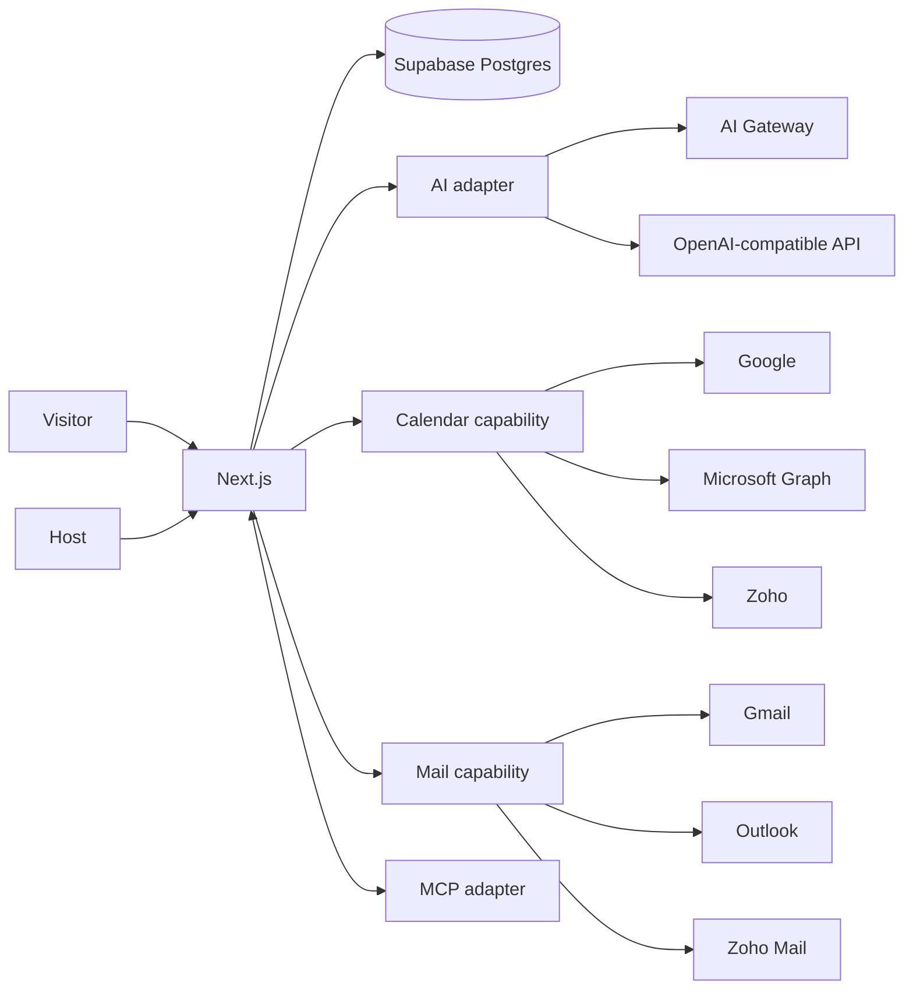

# System Design
## Why
The hardest correctness problem is calendar state, not AI. Booking stays deterministic/provider-backed; AI is optional decision support. A modular monolith is easiest to deploy/debug while ports/adapters preserve portability.

## Booking transaction
Validate → load host policy/account → acquire short DB interval hold → query live provider free/busy → if conflict release+refresh → create provider event → persist booking + idempotency key → consume/release hold → confirm.

## Why live free/busy first
A sync engine adds webhooks, renewals, replay, eventual consistency, dedupe and repair. V0 needs current availability, so live reads reduce stale-state and scope risk.

## Double-booking
Postgres `tstzrange` hold + exclusion constraint prevents overlaps inside our system. Provider availability is rechecked after hold. External calendar writes can still race in a small window; measure and harden provider-specifically before scale.

## AI routing
Plain intent → schema-validated decision. AI cannot mutate calendar directly. Tool execution sits behind application policy + confirmation.

## Provider switching
`AiRuntimeConfig`: `mock`, `gateway`, `openai-compatible`. DB stores model choice + credential reference, not plaintext secret. Calendar and mail have shared capability contracts.

## MCP
Expose the same application services to agents or consume allowlisted remote capabilities. MCP never owns booking truth.

## Deployment
Default Vercel + Supabase. No Vercel-specific domain logic; Docker/standard Postgres remains viable.
