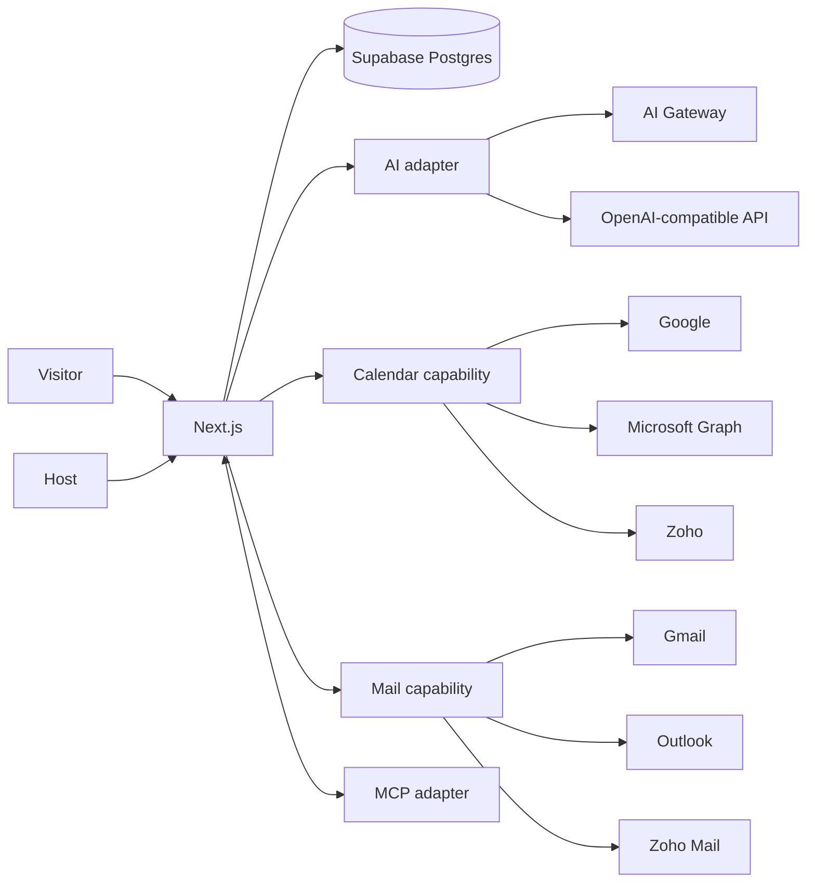

# System Design
## Why
The hardest correctness problem is calendar state, not AI. Booking stays deterministic/provider-backed; AI is optional decision support. A modular monolith is easiest to deploy/debug while ports/adapters preserve portability.

## Booking transaction
M2 (HUMAN-specified order): list slots (live free/busy + DB occupancy + policy) → visitor selects → short DB hold → live re-check → atomic hold→booking (`pending_event`) → create provider event (deterministic event ID) → persist event ID (`confirmed`) → confirm.
Unknown provider outcomes become `needs_reconciliation` (slot kept, never shown as booked). Full sequence, state machine and compensation: `docs/BOOKING_TRANSACTION.md`.

## Why live free/busy first
A sync engine adds webhooks, renewals, replay, eventual consistency, dedupe and repair. V0 needs current availability, so live reads reduce stale-state and scope risk.

## Double-booking
One `bookings` lifecycle table (holds are rows with status `held`) + Postgres `tstzrange` exclusion constraint prevents overlaps inside our system. Provider availability is rechecked after hold. External calendar writes can still race in a small window; measure and harden provider-specifically before scale.

## AI routing
Plain intent → schema-validated decision. AI cannot mutate calendar directly. Tool execution sits behind application policy + confirmation.

## Provider switching
`AiRuntimeConfig`: `mock`, `gateway`, `openai-compatible`. DB stores model choice + credential reference, not plaintext secret. Calendar and mail have shared capability contracts.

## MCP
Expose the same application services to agents or consume allowlisted remote capabilities. MCP never owns booking truth.

## M2 module map
- `src/core/**` — pure, provider-neutral: timezone, policy slots, booking service, store port, calendar adapter contract. No Next.js, no Google types in domain code.
- `src/server/**` — `server-only`: env, crypto (AES-256-GCM, HMAC), sessions/OAuth state, Google OAuth client, credential resolver (refresh/revocation), Postgres store + host repository, rate limits, logging.
- `src/app/api/public/**` — visitor endpoints (validated, rate-limited). `src/app/api/oauth/google/**`, `src/app/api/host/**`, `src/app/dashboard/actions.ts` — host-only, session-scoped.
- Host identity = Google OAuth (sign-in and calendar connection are one step in V0).

## Deployment
Default Vercel + Supabase. No Vercel-specific domain logic; Docker/standard Postgres remains viable.
